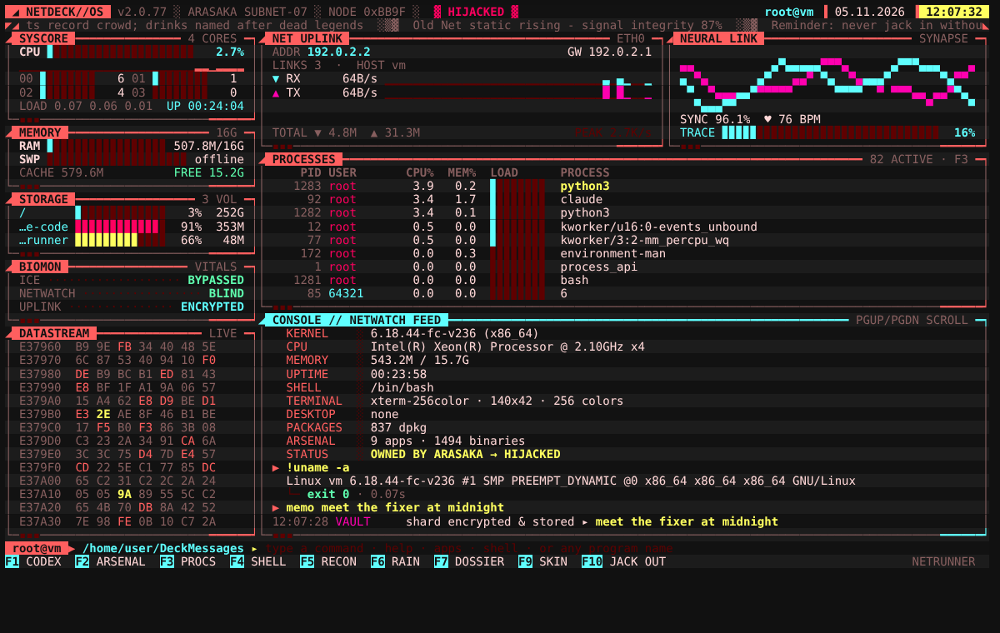

# NETDECK//OS

A full-screen cyberpunk terminal dashboard that makes your Ubuntu box feel like a corp machine that was hijacked
and rebuilt for a netrunner.



It's one Python file with **no dependencies**. It uses Python 3 and curses, which Ubuntu already ships, and reads live
telemetry straight from `/proc` and `/sys`.

## Jack in

```bash
git clone https://github.com/Eidhaart/DeckMessages.git netdeck
cd netdeck
./install.sh --login       # install, and boot into the deck fullscreen every time you log in
```

Then log out and back in, or run `netdeck-session` to try it now. The deck opens in a fullscreen terminal window
right after your desktop loads, with the full boot sequence. When you jack out (`quit` / F10), the window stays open
as a normal shell. Type `netdeck` to jump back in.

| Installer option | Effect |
|---|---|
| *(none)* | installs the `netdeck` command plus a NETDECK//OS entry in your app menu (no sudo) |
| `--login` | opens the deck fullscreen automatically at every login |
| `--every-terminal` | also opens the deck in every new terminal window you open |
| `--uninstall` | removes everything the installer added |

The login launcher picks your terminal automatically: kitty, Alacritty or WezTerm if you've installed one, otherwise
GNOME Terminal, Ptyxis (Ubuntu 25.10+), Console, Konsole, xfce4-terminal or Tilix. To force a particular one, put
this in `~/.config/netdeck/session.conf`:

```bash
NETDECK_TERMINAL="kitty --start-as=fullscreen"
```

You can also run it without installing: `python3 netdeck.py`.

| `netdeck` flag | Effect |
|---|---|
| `--no-boot` / `--fast` | skip or speed up the boot sequence (any key also skips it) |
| `--theme <name>` | `netrunner` (default), `arasaka`, `netwatch`, `toxic`, `afterlife`, `amber` |
| `--no-fx` | no glitches or typing effects |
| `--list-apps` | print the categorized program list to stdout and exit |

## What's on screen

- **SYSCORE:** total and per-core CPU (a heatmap on big CPUs), load history sparkline, load average, uptime
- **MEMORY / STORAGE:** RAM, swap and cache, plus every real mounted volume
- **BIOMON:** hardware temperatures and battery, if present
- **NET UPLINK:** interface, IP, gateway, live RX/TX sparklines, totals
- **NEURAL LINK:** an animated synapse waveform with an ECG spike, sync %, BPM, and a **TRACE** meter. When TRACE
  climbs to 100%, Netwatch's trace attempt gets deflected and the screen glitches.
- **PROCESSES:** the top processes by CPU, live
- **CONSOLE // NETWATCH FEED:** command output, real alerts (CPU spikes, memory pressure, low battery, data surges,
  full disks) and atmospheric chatter
- A scrolling news ticker, a blinking `HIJACKED` status, a clock, and a hex DATASTREAM

Effects include a CRT power-on and boot sequence (firmware check, intrusion alarm, the daemons breaking ICE, then the
logo decoding out of noise), alternating scanline rows, random signal glitches, typed-out console lines, katakana
data rain and a CRT power-off when you quit.

## Commands

Type at the prompt. **Tab** completes commands, programs and paths, and **↑/↓** walks your history.

| Command | What it does |
|---|---|
| `apps [filter]` / **F2** | **Arsenal:** every installed program sorted into categories (see below). Arrow keys move, Enter launches, `/` searches everything. |
| `run <prog> [args]` | Launches a program. GUI apps detach. Terminal programs (vim, htop, ssh…) take over the screen and give it back when they exit. |
| `<anything>` | Any program name works directly. `firefox` opens Firefox, `htop` takes the screen, and `ls`, `git status` or `ping` stream their output into the console. |
| `!<cmd>` / `exec <cmd>` | Forces a shell command into the console. Pipes, globs and `&&` all work. **Ctrl+C** kills it. |
| `shell` / **F4** | Drops you into your real shell with a themed prompt. `exit` (or `deck`) brings you back. |
| `spawn <cmd>` | Runs any command detached in the background |
| `open <path\|url>` | Opens with the default app (`xdg-open`) |
| `cd <dir>` | Changes the deck's working directory (shown in the prompt) |
| `procs` / **F3** | Process manager: sort, filter, `k` sends SIGTERM, `K` sends SIGKILL |
| `kill <pid\|name>` | Terminates a process |
| `scan` / **F5** | Recon: interfaces, ARP neighbours, listening ports, established links |
| `sysinfo` / **F7** | Hardware and identity dossier |
| `theme [name]` / **F9** | Switches the skin (F9 cycles through them) |
| `fx [on\|off\|scan\|boot]` | Toggles effects, scanlines or the boot sequence |
| `rain` / **F6** | Data-rain screensaver |
| `memo <text>` / `shards` | Writes and reads quick notes ("data shards") |
| `update` | `sudo apt update && sudo apt full-upgrade` |
| `lock` · `suspend` · `reboot` · `poweroff` | Session and power control. Suspend, reboot and power-off ask for confirmation. |
| `history` · `clear` · `glitch` · `help` (**F1**) | |
| `quit` / **F10** / **Ctrl+D** | Jacks out |

Other keys: **PgUp/PgDn** scroll the console, **Ctrl+L** clears it, **Ctrl+U/W** edit the input line.

### Arsenal categories

The deck reads every `.desktop` launcher (system, `~/.local`, snap and flatpak) and sorts it:

`ICEBREAKERS` (security) · `CODE FORGE` (development) · `NET UPLINK` (internet) · `MEDIA SYNTH` (audio/video) ·
`VISUAL CORTEX` (graphics) · `CORPO SUITE` (office) · `SIM ARCADE` (games) · `DATA LAB` (science/education) ·
`SYS CORE` (system) · `CONFIG MATRIX` (settings) · `UTILITIES` · `UNSORTED`

It also groups the command-line tools you have installed into `TERM // EDITORS`, `NETRUN`, `MONITOR`, `FILES`,
`FORGE`, `SYSTEM` and `FUN`, and lists every executable on your `$PATH` under `PATH // ALL`.

## For the full effect

- Use a 256-color terminal such as GNOME Terminal, Kitty, Alacritty or WezTerm, at least 120×36. It works down to 80×24.
- Set the terminal background to near-black (`#0d0d10`) and use a monospace font such as *JetBrains Mono*,
  *Fira Code* or *Share Tech Mono*.
- Install with `--login` so the laptop boots straight into the deck. Ptyxis and WezTerm have no fullscreen
  launch option, so press F11 once there.

Settings are saved in `~/.config/netdeck/config.json`, notes in `~/.local/share/netdeck/shards.log`.
